      

# 📱 TokTik Azul — Práctica 04

**TokTik Azul** es una aplicación desarrollada con Flutter y Dart que simula la experiencia de una red social de videos cortos, inspirada en TikTok. Permite explorar videos mediante desplazamiento vertical, interactuar con las publicaciones, guardar preferencias localmente y cambiar la apariencia de la aplicación mediante temas estacionales.

La práctica integra widgets Stateless y Stateful, gestión de estado con Provider, consumo de fuentes de datos remotas, reproducción de video, almacenamiento local y organización del código por capas.

## 🎯 Objetivo principal

Desarrollar una aplicación multiplataforma con Flutter que reproduzca la experiencia básica de un feed de videos cortos, aplicando conceptos de desarrollo móvil como la gestión reactiva del estado, el uso de paquetes externos, el manejo de recursos multimedia, los gestos táctiles, el consumo de APIs y la separación de responsabilidades mediante una arquitectura organizada.

## ✨ Características principales

- **Feed vertical de videos:** desplazamiento entre publicaciones mediante gestos táctiles.
- **Tres secciones:** Discover, For You y Favorites, con navegación horizontal entre feeds.
- **Discover:** catálogo de videos MP4 alojados en Cloudinary y resultados obtenidos de las APIs de Pixabay y Coverr.
- **For You:** videos obtenidos de YouTube Data API v3, con reproducción mediante el reproductor oficial de YouTube.
- **Favorites:** publicaciones marcadas con Me gusta, independientemente de su feed de origen.
- **Interacciones:** Me gusta, contador de vistas, control de audio y descripciones expandibles.
- **Persistencia local:** guarda las interacciones y las preferencias mediante SharedPreferences.
- **Temas estacionales:** modo automático, Normal, Halloween, Navidad y Valentine's Day.
- **Personalización visual:** colores y elementos de identidad visual asociados con la temporada.
- **Recursos multimedia:** reproducción de videos remotos y melodías instrumentales incluidas en los assets.
- **Paginación:** carga de publicaciones adicionales desde las fuentes que admiten paginación.
- **Diseño adaptable:** implementación con Flutter para las plataformas compatibles con el proyecto y sus dependencias.

## 🖼️ Capturas y demostración

A continuación, se muestran las evidencias de la aplicación **TokTik Azul**, incluyendo su interfaz, navegación, reproducción de videos y funcionalidades implementadas.

### 📱 Evidencias de la aplicación


<table>
  <tr>
    <td align="center" width="50%">
      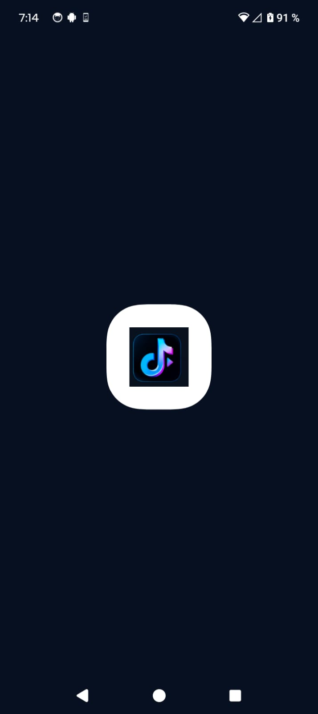
      <br/>
      <strong>Evidencia 1 Logo toktik</strong>
    </td>
    <td align="center" width="50%">
      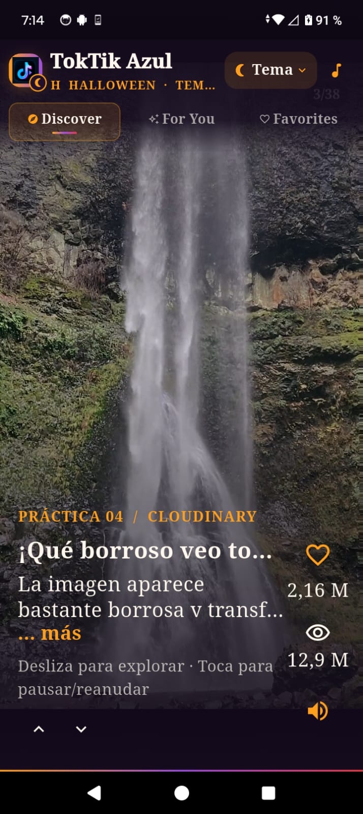
      <br/>
      <strong>Evidencia 2 Interfaz toktik</strong>
    </td>
  </tr>
  <tr>
    <td align="center">
      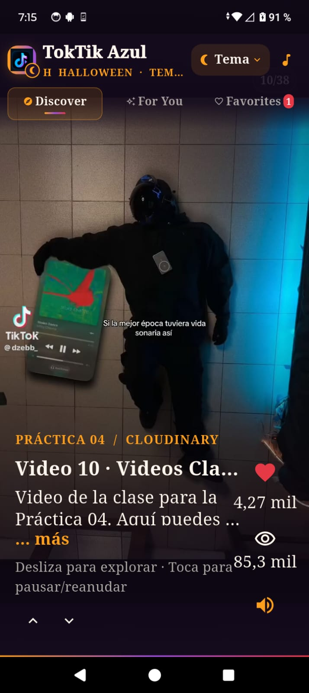
      <br/>
      <strong>Evidencia 3 Like</strong>
    </td>
    <td align="center">
      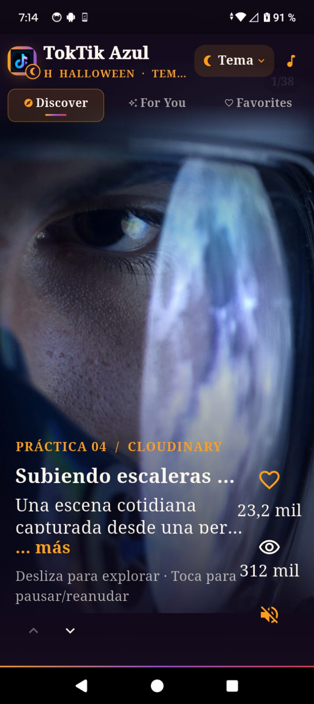
      <br/>
      <strong>Evidencia 4 Mute</strong>
    </td>
  </tr>
  <tr>
    <td align="center">
      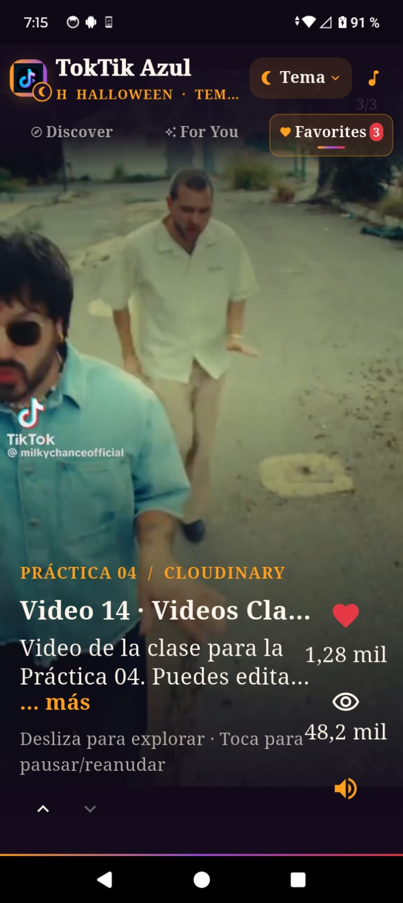
      <br/>
      <strong>Evidencia 5 Vista de favoritos</strong>
    </td>
    <td align="center">
      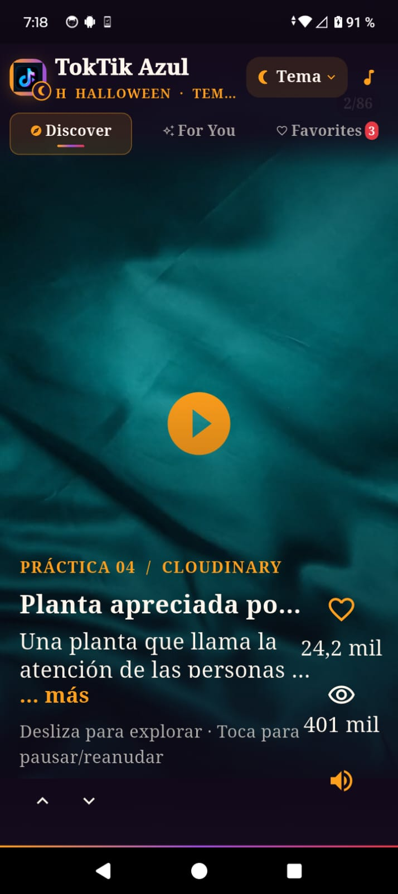
      <br/>
      <strong>Evidencia 6 Boton de Pausa al video</strong>
    </td>
  </tr>
  <tr>
    <td align="center">
      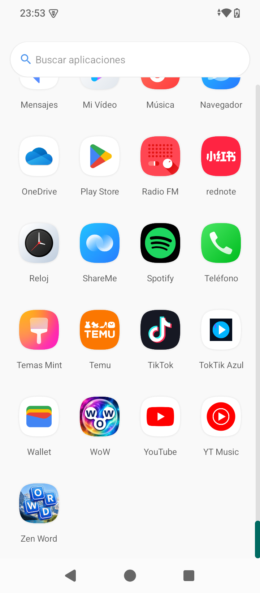
      <br/>
      <strong>Evidencia 7 Icono principal de la apliacion</strong>
    </td>
    <td align="center">
      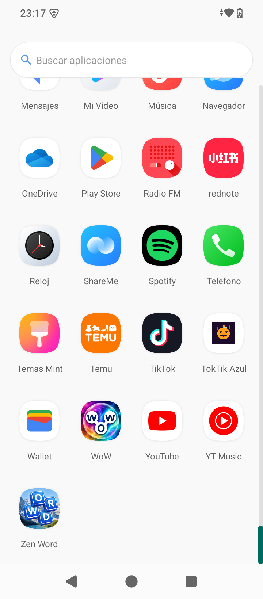
      <br/>
      <strong>Evidencia 8 Icono al cambiar de tema</strong>
    </td>
  </tr>
  <tr>
    <td align="center">
      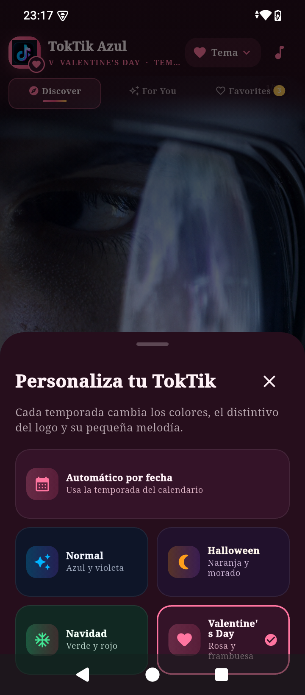
      <br/>
      <strong>Evidencia 9 Seleccion de tema Manual</strong>
    </td>
    <td align="center">
      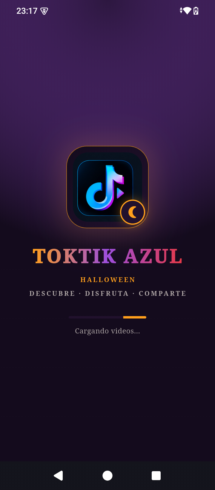
      <br/>
      <strong>Evidencia 10 Cambio de tematizacion en la seleccion de tema</strong>
    </td>
  </tr>
   <tr>
    <td align="center">
      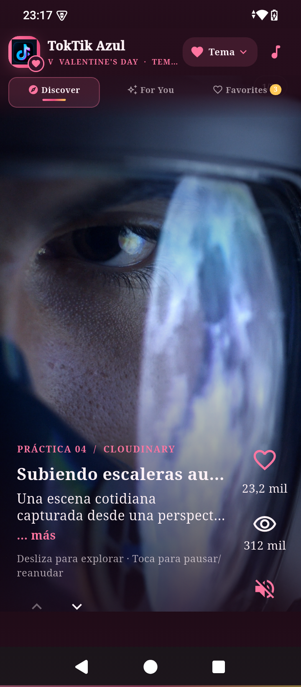
      <br/>
      <strong>Evidencia 9 Seleccion de tema San Valentin de Ejemplo</strong>
    </td>
    <td align="center">
      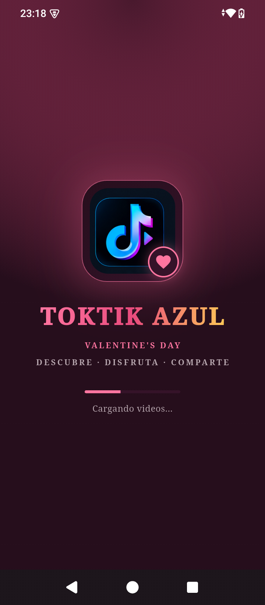
      <br/>
      <strong>Evidencia 10 Cambio de tematizacion en la interfaz (San Valentin)</strong>
    </td>
  </tr>
  <tr>
    <td align="center">
      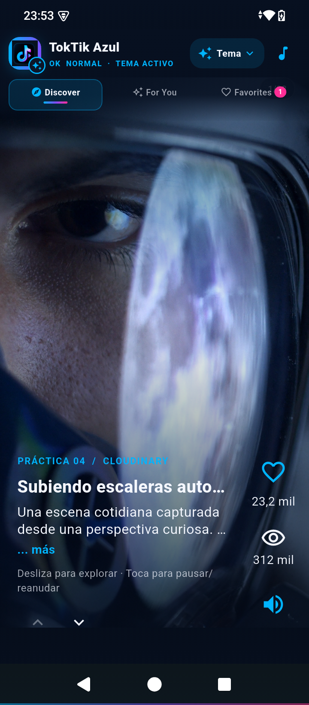
      <br/>
      <strong>Evidencia 9 Tema Automatico Tiktok Azul</strong>
    </td>
    <td align="center">
      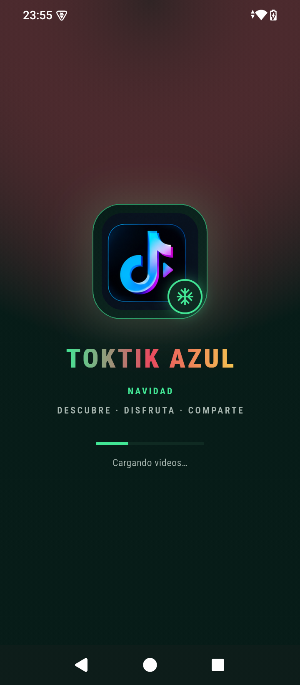
      <br/>
      <strong>Evidencia 10 Cambio de tematizacion en la interfaz (Navidad)</strong>
    </td>
  </tr>
  <tr>
    <td align="center">
      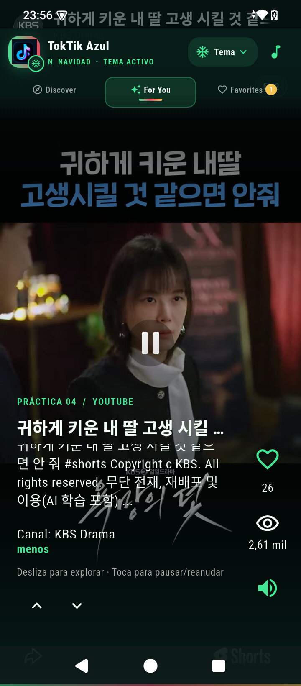
      <br/>
      <strong>Evidencia 9 Despliegue de Ver mas con Scroll</strong>
    </td>
    <td align="center">
      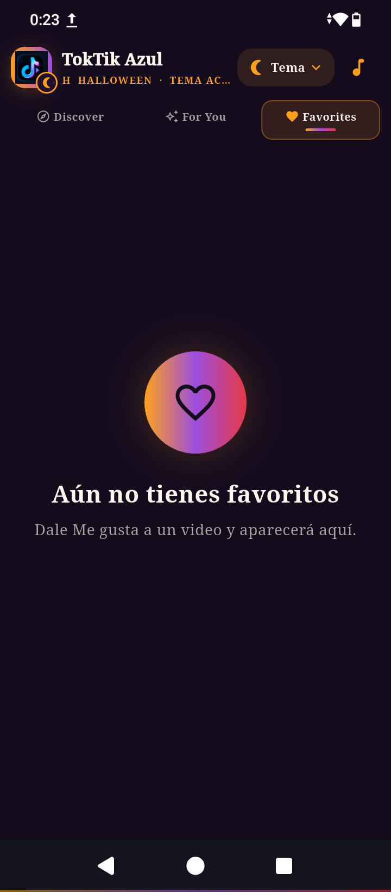
      <br/>
      <strong>Evidencia 10 Seccion sin videos sin Like (Navidad)</strong>
    </td>
  </tr>
</table>

### Video de Funcionalidad en Drive

**[Ver la funcionalidad de la app](https://drive.google.com/file/d/1Fll9HGmq1dMl-p9cP0jmpxSyUQHZ-2CJ/view?usp=drive_link)


### 🏗️ Documentación de arquitectura

**[Ver la arquitectura de la práctica 04 en GitHub Pages](https://obedguzmanguz.github.io/Practicas_DMI_230142/Practica04/docs/arquitectura_interactiva.html)**

La primera vista documenta los providers locales, temas y persistencia con `SharedPreferences`. La segunda recorre `DiscoverProvider`, `VideoRepository`, `CompositeVideoRepository`, las fuentes activas y los reproductores. Las capturas de evidencias existentes se muestran en la sección [Capturas y demostración](#-capturas-y-demostración).

### 🚀 Demostración en línea

La configuración de GitHub Pages no está presente en este checkout, así que no se incluye un enlace de publicación como si estuviera activo. El archivo de arquitectura puede abrirse localmente y publicarse junto con `docs/` cuando Pages se configure.

## 🧰 Tecnologías y herramientas

| Tecnología | Uso |
|---|---|
| Flutter | Framework para desarrollar la interfaz multiplataforma. |
| Dart | Lenguaje principal de programación. |
| Provider | Gestión reactiva del estado y comunicación entre la interfaz y los proveedores de estado. |
| ChangeNotifier | Notificación de cambios de estado a los widgets consumidores. |
| Video Player | Reproducción de archivos de video compatibles con el paquete. |
| In App WebView Flutter | Integración de contenido multimedia mediante vistas web embebidas. |
| HTTP | Solicitudes a APIs y obtención de datos remotos. |
| Shared Preferences | Persistencia local de Me gusta, vistas y preferencias. |
| AudioPlayers | Reproducción de las melodías de temporada. |
| URL Launcher | Apertura de enlaces externos cuando corresponde. |
| Intl | Utilidades de internacionalización y formatos. |
| Flutter Test | Infraestructura para pruebas automatizadas. |
| Git | Control de versiones del código fuente. |
| GitHub | Repositorio remoto y colaboración sobre el código. |
| GitHub Pages | Publicación web de documentación y diagramas, si está habilitada para el repositorio. |
| Codex y Archify | Asistencia para analizar el código y generar diagramas de arquitectura. |

### Shields tecnológicos

Los badges al inicio identifican las principales tecnologías y herramientas del proyecto. Puedes agregar badges adicionales cuando confirmes que una tecnología forma parte de la versión final entregada.

## 🌐 Fuentes de datos y contenido multimedia

La aplicación integra diferentes fuentes para obtener videos. No todas cumplen la misma función.

| Fuente | Uso | Tipo de contenido |
|---|---|---|
| Cloudinary | Catálogo de Discover | URLs de archivos de video MP4 definidos en el proyecto. |
| Pixabay | Catálogo de Discover | Videos consultados mediante Pixabay API. |
| Coverr | Catálogo de Discover | Videos obtenidos mediante Coverr API. |
| YouTube | Feed For You | Metadatos, duración y estadísticas públicas consultadas mediante YouTube Data API v3; reproducción con el reproductor oficial. |
| Vimeo | Adaptador definido en el proyecto | Ejemplo de video con reproductor embebido; no forma parte de las fuentes activas del repositorio compuesto actual. |
| Dailymotion | Adaptador definido en el proyecto | Ejemplo de video con reproductor embebido; no forma parte de las fuentes activas del repositorio compuesto actual. |

**Importante:** en la implementación actual, `CompositeVideoRepository` registra Cloudinary, Pixabay, Coverr y YouTube. Vimeo y Dailymotion tienen adaptadores definidos, pero no están incluidos en la lista predeterminada de fuentes activas.

### ¿Cómo se obtienen los videos?

- **Cloudinary:** utiliza un catálogo definido en el código de la aplicación.
- **Pixabay:** realiza solicitudes HTTP a su API de videos y obtiene URLs MP4.
- **Coverr:** consulta su API y utiliza las URLs de reproducción que devuelve.
- **YouTube:** utiliza `search.list` para localizar videos y `videos.list` para consultar información adicional. La aplicación reproduce el contenido mediante el reproductor oficial, no como un archivo MP4 descargado directamente.

La búsqueda de YouTube utiliza `#shorts` y filtros de duración para aproximarse al formato de videos cortos. La API no garantiza por sí sola que cada resultado tenga orientación vertical.

### Credenciales y configuración

Las fuentes que requieren autenticación utilizan claves de API. Para preparar el entorno local:

1. Revisa `lib/config/api_keys.example.dart`.
2. Crea una copia llamada `lib/config/api_keys.dart`.
3. Agrega tus propias credenciales válidas para las fuentes que quieras habilitar.
4. Comprueba que las APIs correspondientes estén activadas y que las claves tengan las restricciones apropiadas.

**Seguridad:** no publiques claves personales ni las incluyas en commits. Una clave incorporada a una aplicación cliente puede extraerse; para un despliegue de producción conviene evaluar el uso de un backend.

## 🏗️ Arquitectura del proyecto

La aplicación organiza sus responsabilidades en tres capas principales.

### 1. Dominio — Domain

Contiene los elementos centrales de la lógica de negocio:

- `VideoPost`: entidad que representa una publicación de video.
- `VideoRepository`: contrato para obtener los videos y construir los feeds.

### 2. Infraestructura — Infrastructure

Se encarga de la obtención, normalización y persistencia de los datos:

- `datasources/`: adaptadores para Cloudinary, Pixabay, Coverr y YouTube.
- `models/`: modelos utilizados para representar los datos recibidos.
- `mappers/`: transformación de los registros a la entidad común.
- `repositories/`: composición de fuentes y reglas de los feeds.
- `storage/`: persistencia local mediante SharedPreferences.

### 3. Presentación — Presentation

Contiene la interfaz y la gestión del estado:

- `DiscoverProvider`: gestiona feeds, Me gusta, vistas, sonido y carga de publicaciones.
- `SeasonalThemeProvider`: gestiona el tema, su persistencia y las melodías.
- `DiscoverScreen`: navegación entre las secciones.
- `VideoScrollableView`: composición del feed vertical.
- `FullScreenPlayer`: reproducción de videos compatibles con Video Player.
- `EmbeddedPlatformPlayer`: integración con el reproductor de YouTube.

## 📐 Diagramas de arquitectura solicitados

La documentación debe incluir los siguientes dos diagramas, generados a partir del código real.

### Diagrama 1. Provider local

Representa el funcionamiento de los providers y el almacenamiento local sin profundizar en el repositorio compuesto ni en los adaptadores de las APIs.

Debe incluir:

- Interfaz Flutter y widgets Stateless/Stateful.
- `DiscoverProvider`.
- `SeasonalThemeProvider`.
- `LocalVideoStorage` y `LocalSettingsStorage`.
- SharedPreferences.
- Fecha del dispositivo y selección de temporada.
- Assets de audio y reproducción de video.
- Plataformas de proyecto.
- Desarrollo y documentación con Git, GitHub, GitHub Pages y Archify.

### Diagrama 2. Provider mediante repositorio y datasources

Representa el flujo desde la interfaz hasta las fuentes de video.

Debe incluir:

- Widgets y pantallas Flutter.
- `DiscoverProvider`.
- Contrato `VideoRepository`.
- `CompositeVideoRepository`.
- `VideoPostMapper`, modelos y entidad `VideoPost`.
- Cloudinary, Pixabay, Coverr y YouTube Data API v3.
- Reproductores de video y persistencia de interacciones.
- Plataformas de proyecto.
- Desarrollo y documentación con Git, GitHub, GitHub Pages y Archify.

Los diagramas editables y las imágenes finales deben estar organizados dentro de `docs/diagramas/`. La explicación completa se encuentra en `docs/ARQUITECTURA.md`.

## 📅 Temas estacionales

La aplicación cuenta con un modo automático basado en la fecha del dispositivo y con opciones manuales.

| Tema | Regla automática |
|---|---|
| Halloween | Octubre y del 1 al 2 de noviembre. |
| Navidad | Diciembre. |
| Valentine's Day | Del 1 al 14 de febrero. |
| Normal | Cualquier otra fecha. |

La selección se guarda localmente para conservar la preferencia. Los recursos de audio se encuentran en `assets/audio/`.

## 💾 Persistencia local

La aplicación utiliza SharedPreferences para conservar información entre sesiones:

- Identificadores de videos marcados con Me gusta.
- Contadores personales de vistas.
- Modo de tema estacional seleccionado.

Estos datos se almacenan en el dispositivo y no modifican las estadísticas reales de las plataformas externas.

## 🚀 Instalación y ejecución

### Requisitos

- Flutter SDK compatible con las restricciones de `pubspec.yaml`.
- Dart SDK compatible con la versión del proyecto.
- Android Studio o Visual Studio Code.
- Dispositivo Android o emulador configurado.
- Conexión a internet para consultar las fuentes remotas.
- Credenciales de las APIs que requieran autenticación.

### Pasos

Abre una terminal dentro de `toktik_app_` y ejecuta:

```bash
flutter pub get
flutter analyze
flutter test
flutter run
```

Para comprobar los dispositivos disponibles:

```bash
flutter devices
```

Para ejecutar en Chrome, si el entorno y las dependencias lo permiten:

```bash
flutter run -d chrome
```


## 🌍 GitHub Pages

**[Ver la arquitectura de la práctica 04 en GitHub Pages](https://obedguzmanguz.github.io/Practicas_DMI_230142/Practica04/docs/arquitectura_interactiva.html)**

## 🔧 Desarrollo y documentación

El control de versiones se realiza con Git y el código fuente se aloja en GitHub. GitHub Pages puede utilizarse para publicar las evidencias web, mientras que Archify se emplea para construir diagramas interactivos de arquitectura a partir del análisis del proyecto.

Flujo de trabajo:

1. Desarrollar y probar la aplicación localmente.
2. Guardar los cambios mediante Git.
3. Publicar el repositorio en GitHub.
4. Generar y validar los diagramas de arquitectura.
5. Incorporar los diagramas y su explicación a `docs/`.
6. Publicar la documentación en GitHub Pages, cuando esté configurado.

## 📚 Documentación de referencia

- [Flutter](https://docs.flutter.dev/)
- [Dart](https://dart.dev/)
- [Provider](https://pub.dev/packages/provider)
- [Video Player](https://pub.dev/packages/video_player)
- [Shared Preferences](https://pub.dev/packages/shared_preferences)
- [YouTube Data API v3](https://developers.google.com/youtube/v3/docs)
- [Pixabay API](https://pixabay.com/api/docs/)
- [Coverr API](https://api.coverr.co/docs)
- [Archify](https://github.com/tt-a1i/archify)

## 👨‍💻 Autoría

**Práctica 04 — Desarrollo de aplicaciones móviles con Flutter**

Proyecto académico desarrollado para poner en práctica widgets, gestión de estado, consumo de APIs, reproducción de video, almacenamiento local y documentación de arquitectura.

---

*TokTik Azul: una práctica de desarrollo móvil centrada en la exploración de videos cortos, la gestión del estado y la integración de fuentes multimedia.*
