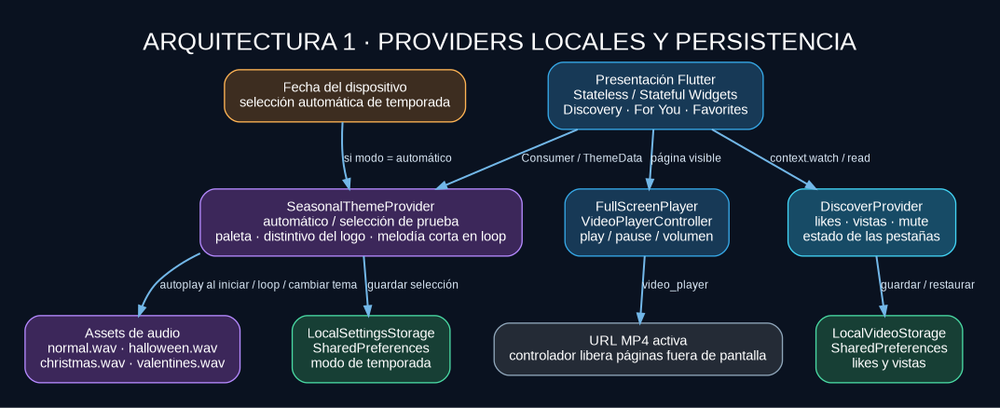
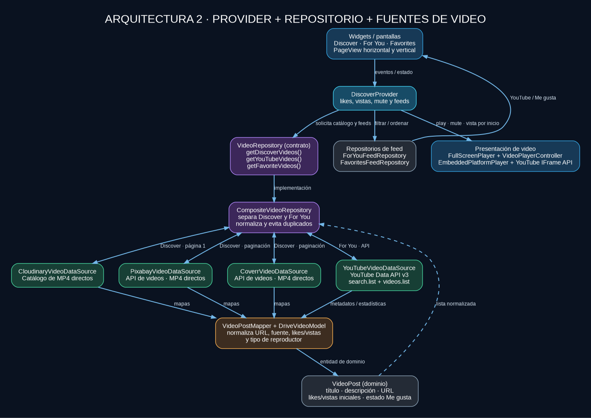

# Arquitectura de TokTik Azul

## Diagrama 1. Providers locales y persistencia

`DiscoverProvider` administra la navegación por los feeds y las interacciones: Me gusta, vistas y sonido de los videos. Usa `LocalVideoStorage` para persistir las interacciones. `SeasonalThemeProvider` carga el tema guardado o calcula una temporada con la fecha del dispositivo, notifica el cambio de paleta y reproduce la melodía asociada. El usuario puede elegir manualmente el tema o regresar a `Automático por fecha`.

Los archivos de audio son melodías instrumentales cortas que se repiten hasta silenciarlas o seleccionar otro tema. El distintivo del logo y los colores de la aplicación también cambian para reforzar la temporada activa.

## Diagrama 2. Provider, repositorio y fuentes de video

`DiscoverProvider` utiliza el contrato de dominio `VideoRepository`. `CompositeVideoRepository` conserva separadas las dos fuentes de los feeds:

- **Discover:** catálogo MP4 de Cloudinary y APIs de Pixabay y Coverr.
- **For You:** resultados de búsqueda de YouTube Data API v3, sin sustituirlos por videos de otras fuentes.
- **Favorites:** videos de cualquiera de los dos feeds que tengan Me gusta activo.

Los mapas de cada fuente pasan por `VideoPostMapper` y `DriveVideoModel` para producir la entidad común `VideoPost`. Los widgets no realizan solicitudes HTTP directamente.

## Capas

### Dominio

- `VideoPost`: entidad central que conserva URL, fuente, contadores y estado de Me gusta.
- `VideoRepository`: define cómo obtener videos de Discover y YouTube, además de los feeds Para ti y Favoritos.

### Infraestructura

- `datasources/`: adaptadores de Cloudinary, Pixabay, Coverr y YouTube Data API v3.
- `mappers/` y `models/`: convierten respuestas de las fuentes a entidades de dominio.
- `repositories/`: separa las fuentes activas y aplica las reglas de cada feed.
- `storage/`: persiste vistas, Me gusta y preferencias estacionales con `SharedPreferences`.

### Presentación

- `DiscoverProvider`: estado de likes, vistas, mute y feeds.
- `SeasonalThemeProvider`: selección y persistencia del tema, además de la reproducción de música.
- `DiscoverScreen`: navegación horizontal entre secciones y selector visual de temporadas.
- `VideoScrollableView`: navegación vertical y composición de reproductores con `Stack` y `Positioned`.
- `FullScreenPlayer`: controla los videos MP4 y notifica cada inicio de reproducción.
- `EmbeddedPlatformPlayer`: usa el reproductor oficial de YouTube y el evento `PLAYING` para registrar cada inicio de reproducción.

## Reglas de temporada

| Modo | Regla automática |
| --- | --- |
| Halloween | Octubre y del 1 al 2 de noviembre |
| Navidad | Diciembre |
| Valentine's Day | Del 1 al 14 de febrero |
| Normal | Cualquier otra fecha |

El selector conserva el modo (`automatic`, `normal`, `halloween`, `christmas` o `valentinesDay`) en `toktik_season_mode`.

## Vistas y favoritos

Cada inicio de reproducción incrementa el contador de vistas y guarda el nuevo valor localmente. El reproductor de YouTube usa el evento de estado `PLAYING`; el reproductor MP4 registra el inicio de `play`. Los favoritos se calculan usando exclusivamente videos marcados con Me gusta y la selección permanece al reiniciar la app.

Las estadísticas iniciales de YouTube se consultan mediante `videos.list` cuando la API las devuelve. Los contadores personales se guardan en el dispositivo y no modifican las estadísticas reales del video en YouTube.

## Consideraciones de las APIs

- Las fuentes remotas requieren conexión a internet y las claves válidas.
- La clave de YouTube debe tener habilitada YouTube Data API v3 y estar restringida a esa API.
- YouTube entrega metadatos y estadísticas; la reproducción se realiza en su reproductor oficial.
- Algunas publicaciones o videos pueden no admitir reproducción integrada.
- Las claves de APIs incluidas en código cliente sirven solo para pruebas locales y no deben tratarse como secretos de producción.
