# Práctica 05 — Laboratorio Digital

Aplicación multiplataforma desarrollada con **Flutter y Dart** que reúne ejemplos interactivos de componentes de interfaz. El proyecto funciona como un laboratorio para explorar widgets de Flutter, practicar el manejo de estado, probar distintos controles y observar animaciones y cambios de tema desde una misma aplicación.

<p align="center">
  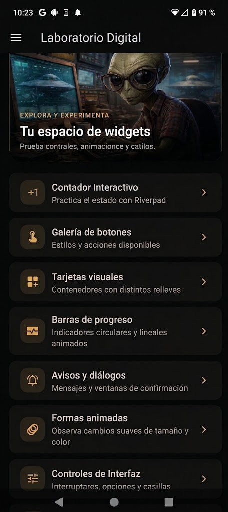
</p>

<p align="center">
  <strong>Laboratorio Digital · Widgets, controles, navegación y animaciones</strong>
</p>

---

## ¿Qué es la práctica?

La práctica consiste en construir una aplicación de demostración donde cada apartado presenta un grupo de widgets o una técnica de desarrollo de interfaces en Flutter. Desde la pantalla principal se puede entrar a diez módulos independientes y experimentar con sus elementos.

La aplicación utiliza una interfaz oscura con acentos de color configurables. La navegación entre pantallas se organiza mediante rutas, mientras que Riverpod administra el contador y el tema global. Algunos módulos conservan su propio estado local para actualizar controles y animaciones.

## Objetivo

Aplicar los fundamentos de desarrollo de interfaces móviles con Flutter mediante la creación de una aplicación organizada por módulos, que permita:

- Identificar y utilizar distintos widgets de Material Design.
- Implementar navegación entre pantallas con rutas definidas.
- Gestionar estado global y estado local.
- Crear animaciones e indicadores de progreso.
- Construir controles interactivos y mostrar mensajes o diálogos.
- Personalizar la apariencia de la aplicación mediante temas y colores.

## ¿Para qué sirve?

Sirve como material de práctica y consulta para comprender cómo se construyen elementos comunes de una interfaz. También permite observar cómo se conectan las pantallas, cómo cambia la interfaz al modificar el estado y cómo se organizan archivos de configuración, proveedores, pantallas y widgets reutilizables dentro de un proyecto Flutter.

> **Alcance:** es una aplicación educativa de demostración. No contiene backend, base de datos, autenticación ni almacenamiento persistente. La galería desplazable simula la incorporación de más elementos en memoria; no consume un servicio de paginación. Algunas ilustraciones se cargan desde Internet, por lo que necesitan conexión para mostrarse.

---

## Módulos de la aplicación

| Módulo | ¿Qué permite explorar? | Archivo principal |
|---|---|---|
| **Contador interactivo** | Incrementar un valor y observar cómo Riverpod actualiza la interfaz. También permite cambiar el modo visual desde la barra superior. | `lib/presentation/screens/counter/counter_screen.dart` |
| **Galería de botones** | Comparar botones elevados, rellenos, con contorno, de texto, con iconos y un botón personalizado. | `lib/presentation/screens/buttons/buttons_screen.dart` |
| **Tarjetas visuales** | Observar tarjetas con diferentes niveles de elevación, contorno, relleno e imagen. | `lib/presentation/screens/cards/cards_screen.dart` |
| **Indicadores de progreso** | Visualizar indicadores circulares y lineales, incluyendo una animación de progreso repetitiva. | `lib/presentation/screens/progress/progress_screen.dart` |
| **Avisos y diálogos** | Mostrar un `SnackBar`, un diálogo de confirmación y una ventana con información de la aplicación. | `lib/presentation/screens/snackbar/snackbar_screen.dart` |
| **Formas animadas** | Cambiar aleatoriamente el tamaño, color y radio de borde de un `AnimatedContainer`. | `lib/presentation/screens/animated/animated_screen.dart` |
| **Controles de interfaz** | Probar un interruptor, opciones de selección y casillas de verificación. | `lib/presentation/screens/ui_controls/ui_controls_screen.dart` |
| **Guía de bienvenida** | Recorrer una introducción de tres páginas mediante un `PageView`. | `lib/presentation/screens/app_tutorial/app_tutorial_screen.dart` |
| **Galería desplazable** | Practicar desplazamiento, actualización mediante gesto y carga simulada de más elementos. | `lib/presentation/screens/infinite_scroll/infinite_scroll_screen.dart` |
| **Personalizar colores** | Cambiar entre modo claro y oscuro y elegir uno de nueve colores de acento. | `lib/presentation/screens/theme_changer/theme_changer_screen.dart` |

---

## Diagrama de arquitectura

El diagrama de arquitectura se generará como una página interactiva con **Archify** y se publicará mediante **GitHub Pages**. La vista deberá mostrar las plataformas de ejecución, el arranque de Flutter, la navegación, la configuración, los proveedores de estado, las pantallas y los recursos utilizados.

## 🏗️ Diagrama de arquitectura

[](https://obedguzmanguz.github.io/Practicas_DMI_230142/Practica05/docs/architecture.archify.html)

**[Ver arquitectura interactiva de la práctica 05 en GitHub Pages](https://obedguzmanguz.github.io/Practicas_DMI_230142/Practica05/docs/architecture.archify.html)**
La copia ZIP revisada no incluye la carpeta `.git`, un remoto de GitHub ni la configuración de GitHub Pages; por eso todavía no es posible determinar una URL pública real. El archivo `PROMPT_CODEX_ARCHIFY.md` contiene las instrucciones para que Codex examine el código y genere el diagrama. El diagrama debe permitir seleccionar cada bloque y consultar su descripción, símbolos relevantes, archivo fuente, líneas de código y enlace directo al código en GitHub cuando el remoto esté configurado.

### Plataformas contempladas

El proyecto contiene las carpetas y archivos de plataforma de Flutter para:

- Android
- iOS
- Web
- Windows
- Linux
- macOS

La lógica de la aplicación está escrita principalmente en Dart/Flutter. Los directorios nativos contienen los proyectos de soporte y compilación correspondientes a cada plataforma.

---

## Capturas de pantalla

Las capturas se encuentran en la carpeta `assets/` de este repositorio y se presentan siguiendo el recorrido de la aplicación.

<table>
  <tr>
    <td align="center" valign="top"><strong>1. Pantalla principal</strong><br><sub>Acceso a los módulos del laboratorio.</sub><br></td>
    <td align="center" valign="top"><strong>2. Guía de bienvenida</strong><br><sub>Introducción y recorrido inicial.</sub><br>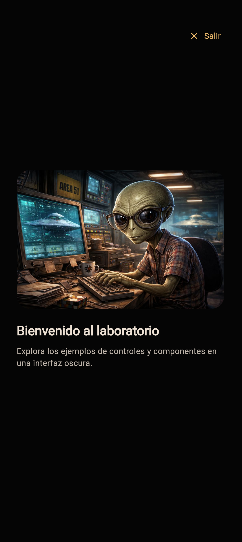</td>
  </tr>
  <tr>
    <td align="center" valign="top"><strong>3. Contador interactivo</strong><br><sub>Estado administrado con Riverpod.</sub><br>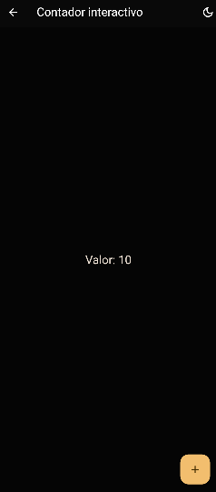</td>
    <td align="center" valign="top"><strong>4. Galería de botones</strong><br><sub>Estilos, variantes e iconos.</sub><br>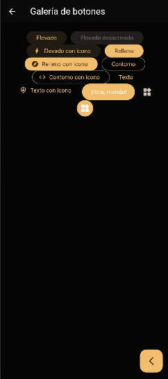</td>
  </tr>
  <tr>
    <td align="center" valign="top"><strong>5. Tarjetas visuales</strong><br><sub>Elevación, contorno, relleno e imagen.</sub><br>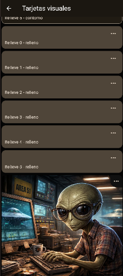</td>
    <td align="center" valign="top"><strong>6. Indicadores de progreso</strong><br><sub>Indicadores circulares y lineales animados.</sub><br>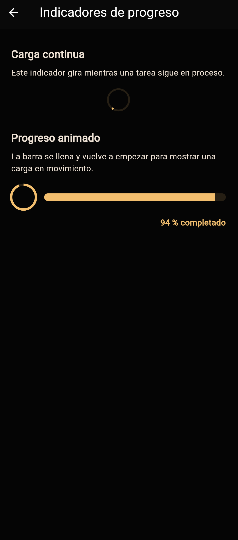</td>
  </tr>
  <tr>
    <td align="center" valign="top"><strong>7. Avisos y diálogos</strong><br><sub>Mensajes emergentes y confirmaciones.</sub><br>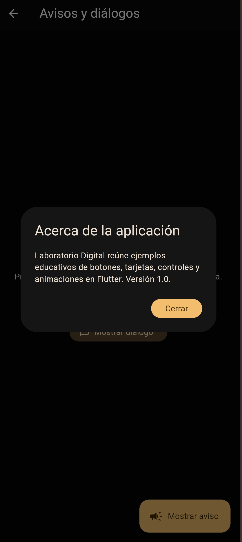</td>
    <td align="center" valign="top"><strong>8. Formas animadas</strong><br><sub>Cambios dinámicos de forma y color.</sub><br>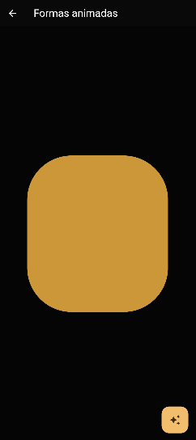</td>
  </tr>
  <tr>
    <td align="center" valign="top"><strong>9. Controles de interfaz</strong><br><sub>Switch, radio buttons y checkboxes.</sub><br>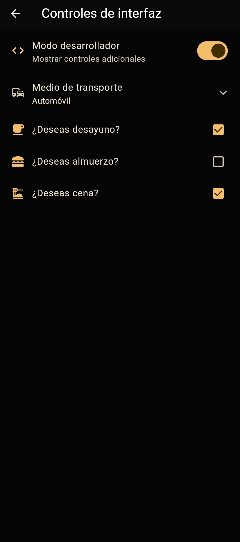</td>
    <td align="center" valign="top"><strong>10. Galería desplazable</strong><br><sub>Desplazamiento y carga simulada.</sub><br>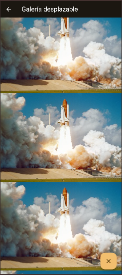</td>
  </tr>
  <tr>
    <td align="center" valign="top"><strong>11. Personalización del tema</strong><br><sub>Selección de colores de acento.</sub><br>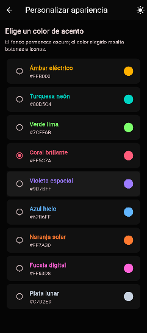</td>
    <td align="center" valign="top"><strong>12. Interfaz con otro acento</strong><br><sub>Ejemplo de la apariencia con color azul.</sub><br>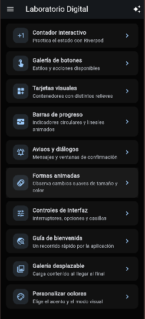</td>
  </tr>
</table>

---

## Tecnologías utilizadas

| Tecnología | Badge | Uso dentro del proyecto |
|---|---|---|
| **Flutter** |  | Framework principal para construir la interfaz y compilar la aplicación en distintas plataformas. |
| **Dart** |  | Lenguaje utilizado para la lógica, widgets, navegación y estado. |
| **Material Design 3** |  | Sistema visual de componentes, temas, botones, tarjetas y controles. |
| **Riverpod** |  | Administración del estado del contador y del tema global. |
| **GoRouter** |  | Definición de rutas y navegación entre las pantallas. |
| **animate	extunderscore do** |  | Efectos de entrada y animaciones en la guía y la galería desplazable. |
| **flutter	extunderscore lints** |  | Reglas de análisis estático para mantener consistencia en el código Dart. |
| **Git / GitHub** |   | Herramientas previstas para versionar y alojar el código fuente. La copia ZIP no incluye los datos del remoto. |
| **GitHub Pages** |  | Publicación prevista del sitio estático con el diagrama interactivo. |
| **Archify** |  | Herramienta prevista para generar y documentar visualmente la arquitectura. |

### Dependencias principales

Las versiones indicadas se tomaron de `pubspec.yaml` y `pubspec.lock`:

```yaml
dependencies:
  animate_do: ^5.1.0
  flutter_riverpod: ^3.3.2
  go_router: ^17.3.0
```

El proyecto también utiliza `flutter_test` y `flutter_lints` como dependencias de desarrollo. El lockfile requiere Flutter **3.38.0 o superior** y Dart **3.11.0 o superior**.

---

## Estructura del proyecto

```text
Practica05/
├── README.md
├── PROMPT_CODEX_ARCHIFY.md
├── assets/                         # Capturas de pantalla de la práctica
└── widgets-app/
    ├── android/                    # Proyecto de plataforma Android
    ├── ios/                        # Proyecto de plataforma iOS
    ├── web/                        # Configuración para navegador
    ├── windows/                    # Proyecto de plataforma Windows
    ├── linux/                      # Proyecto de plataforma Linux
    ├── macos/                      # Proyecto de plataforma macOS
    ├── assets/images/              # Recursos gráficos utilizados por la app
    ├── lib/
    │   ├── main.dart               # Punto de entrada y ProviderScope
    │   ├── config/
    │   │   ├── menu/               # Elementos del menú
    │   │   ├── router/             # Rutas de GoRouter
    │   │   └── theme/              # Tema y paleta de colores
    │   └── presentation/
    │       ├── providers/          # Estado global con Riverpod
    │       ├── screens/            # Pantallas de los diez módulos
    │       └── widgets/            # Widgets reutilizables
    ├── pubspec.yaml                # Dependencias y configuración Flutter
    └── pubspec.lock                # Versiones resueltas de dependencias
```

---

## Instalación y ejecución

### Requisitos

- Flutter 3.38.0 o superior.
- Dart 3.11.0 o superior (incluido con Flutter).
- Visual Studio Code o Android Studio.
- Un emulador, dispositivo físico o plataforma de escritorio compatible.

### Pasos

1. Clona o descarga el repositorio y abre la carpeta `widgets-app` en la terminal.
2. Instala las dependencias:

   ```bash
   flutter pub get
   ```

3. Ejecuta la aplicación en el dispositivo disponible:

   ```bash
   flutter run
   ```

### Ejecutar en un destino específico

```bash
flutter run -d chrome       # Web
flutter run -d windows      # Windows
flutter run -d linux        # Linux
flutter run -d macos        # macOS (desde macOS)
```

Para Android, conecta un dispositivo o inicia un emulador y ejecuta `flutter devices` para consultar el identificador disponible. La compilación para iOS requiere macOS y Xcode.

### Generar una compilación Android

```bash
flutter build apk
```

---

## Observaciones técnicas

- El punto de entrada está en `lib/main.dart`, donde `ProviderScope` habilita Riverpod y `MaterialApp.router` utiliza la configuración de GoRouter.
- Las rutas se centralizan en `lib/config/router/app_router.dart` y el menú se define en `lib/config/menu/menu_items.dart`.
- El tema global se gestiona mediante `ThemeNotifier` en `lib/presentation/providers/theme_provider.dart`.
- El contador utiliza `counterProvider` en `lib/presentation/providers/counter_provider.dart`.
- La galería desplazable incorpora elementos después de una espera simulada y utiliza una imagen de red; no realiza solicitudes a un backend.
- Algunas vistas descargan imágenes externas. Si no hay conexión o el servidor remoto no responde, esas imágenes pueden no mostrarse.

---

## Autoría y propósito académico

Proyecto realizado como práctica académica para reforzar el desarrollo de interfaces con Flutter, el uso de widgets, la navegación, la administración de estado y la construcción de componentes visuales interactivos.
