<div align="center">

# 🎬 Cinemapedia App

### Descubre, disfruta y vive el cine.

**Aplicación multiplataforma para explorar películas y series, consultar información, descubrir tráileres y guardar favoritos.**

[](https://flutter.dev/)
[](https://dart.dev/)
[](https://www.themoviedb.org/)
[](https://docs.flutter.dev/platform-integration)

</div>

---

## 📌 Descripción

**Cinemapedia** es una aplicación desarrollada con **Flutter y Dart** que permite descubrir películas y series mediante la API de **[The Movie Database (TMDB)](https://www.themoviedb.org/)**. Reúne en una sola interfaz la exploración de catálogos, búsqueda, información detallada, reparto, tráileres, clasificaciones regionales y listas personales de favoritos.

La aplicación permite alternar entre contenido de películas y series, seleccionar región e idioma y personalizar la apariencia mediante los temas claro y oscuro.

> 🍿 **Eslogan:** *Descubre, disfruta y vive el cine.*

## 🧭 Contenido

- [Características principales](#-características-principales)
- [Evidencias de la aplicación](#-evidencias-de-la-aplicación)
- [Diagrama de arquitectura](#-diagrama-de-arquitectura)
- [Tecnologías utilizadas](#-tecnologías-utilizadas)
- [Requisitos](#-requisitos)
- [Instalación y configuración](#-instalación-y-configuración)
- [Estructura del proyecto](#-estructura-del-proyecto)
- [Seguridad](#-seguridad)
- [Comandos útiles](#-comandos-útiles)

## ✨ Características principales

### 🏠 Inicio y navegación

- Pantalla de bienvenida animada y carga inicial del catálogo.
- Carrusel automático con flechas, indicadores de posición y controles de doble toque para ir al primer o último elemento.
- Título, sinopsis breve, calificación y clasificación en el carrusel.
- Listas horizontales de **En cines / En emisión**, **Próximamente** y **Mejor calificadas**.
- Paginación automática al acercarse al final de las listas.
- Barra inferior fija con accesos a **Inicio, Populares, Categorías y Favoritos**.
- Al seleccionar Inicio cuando ya está abierta esa sección, la vista regresa a la parte superior.

### 🎞️ Películas y series

- Selector de contenido en Configuración para alternar entre películas y series.
- Inicio, Populares, Favoritos, Categorías, búsqueda y detalle adaptados al tipo de contenido seleccionado.
- Consumo de los endpoints de películas y TV de TMDB.
- Pantalla de Populares en cuadrícula tipo *masonry* con carga al desplazarse.
- Secciones de películas en cartelera, próximos estrenos y mejor calificadas.
- Secciones de series en emisión, próximas y mejor calificadas.
- Detalle con póster, título, sinopsis, géneros, fecha, calificación y clasificación regional.
- Reparto, tráiler de YouTube y títulos similares.

### 🔎 Búsqueda y favoritos

- Sugerencias de búsqueda con una espera breve para evitar solicitudes por cada tecla.
- Botón de corazón para agregar o quitar películas y series de Favoritos.
- Favoritos persistentes mediante **SharedPreferences**, guardados localmente y separados por tipo de contenido.
- Pantalla de Favoritos con mensaje y acceso a la búsqueda cuando la lista está vacía.

### 🌎 Idioma y configuración

- Selector regional: México (español), Estados Unidos (inglés), Japón (japonés), Alemania (alemán), China (chino) y Arabia Saudita (árabe).
- La selección de región e idioma se conserva al cerrar y volver a abrir la aplicación.
- Los textos de la interfaz se localizan y TMDB recibe el idioma seleccionado para los títulos y sinopsis.
- Cuando TMDB no devuelve una sinopsis en el idioma elegido, se intenta utilizar la versión en inglés.
- La interfaz conserva la orientación de izquierda a derecha al utilizar árabe.
- Modos claro y oscuro.

### 🎨 Diseño y experiencia

- Tarjetas de póster con calificación en la parte inferior izquierda, clasificación en la parte inferior derecha y acceso a Favoritos.
- Iconografía renovada, superficies redondeadas y animaciones sutiles.
- Estados de carga, mensajes de error y opción para reintentar cuando falla la conexión o la configuración de TMDB.

> **Nota sobre clasificaciones:** si TMDB no entrega una clasificación para la región seleccionada, se muestra `NR` (sin clasificación disponible). Las clasificaciones se consultan por identificador y tipo de contenido; el detalle realiza su consulta regional correspondiente.

## 🖼️ Evidencias de la aplicación

Las siguientes capturas muestran las pantallas y funciones principales de Cinemapedia. Las imágenes están organizadas en la carpeta [`Evidencias`](Evidencias/) de esta práctica.

<table>
  <tr>
    <td align="center" width="33%">
      <strong>🏠 Pantalla de inicio</strong><br>
      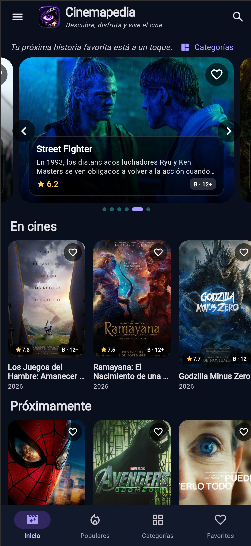
    </td>
    <td align="center" width="33%">
      <strong>⏳ Pantalla de carga</strong><br>
      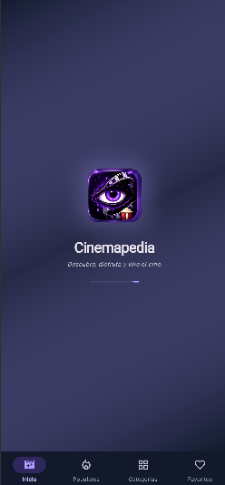
    </td>
    <td align="center" width="33%">
      <strong>📺 Sección de series</strong><br>
      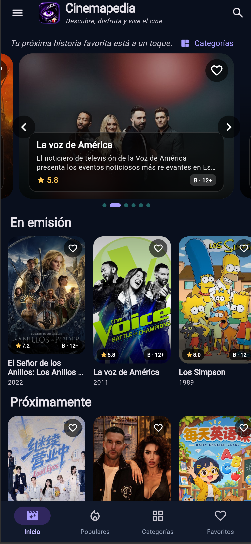
    </td>
  </tr>
  <tr>
    <td align="center">
      <strong>🔥 Películas populares</strong><br>
      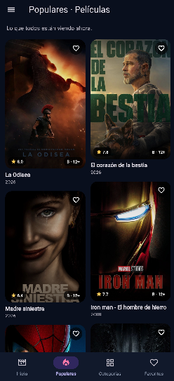
    </td>
    <td align="center">
      <strong>🗂️ Categorías</strong><br>
      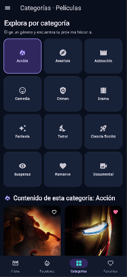
    </td>
    <td align="center">
      <strong>❤️ Favoritos</strong><br>
      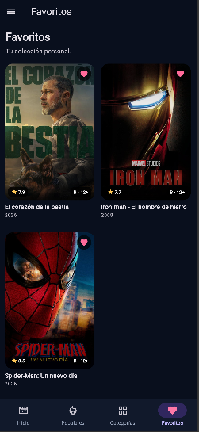
    </td>
  </tr>
  <tr>
    <td align="center">
      <strong>🔎 Búsqueda</strong><br>
      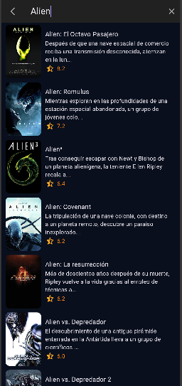
    </td>
    <td align="center">
      <strong>🎬 Detalle de película</strong><br>
      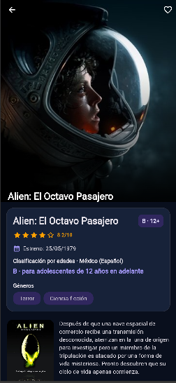
    </td>
    <td align="center">
      <strong>🎭 Reparto y actores</strong><br>
      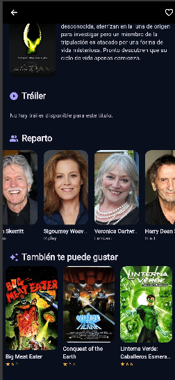
    </td>
  </tr>
  <tr>
    <td align="center">
      <strong>⚙️ Opciones y configuración</strong><br>
      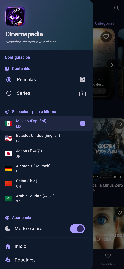
    </td>
    <td align="center">
      <strong>🌐 Cambio de idioma</strong><br>
      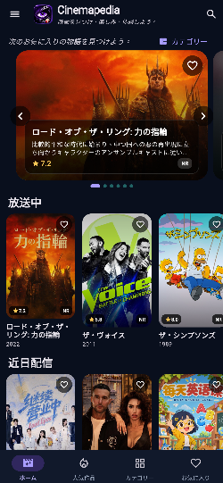
    </td>
    <td align="center">
      <strong>☀️ Modo claro</strong><br>
      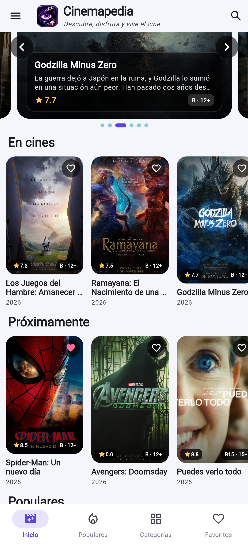
    </td>
  </tr>
  <tr>
    <td align="center">
      <strong>📱 Icono de la aplicación</strong><br>
      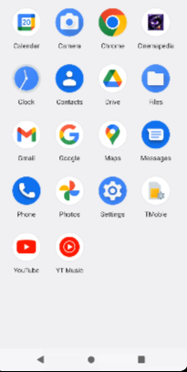
    </td>
    
  </tr>
</table>

## 🏗️ Diagrama de arquitectura

La arquitectura documenta las capas internas de Cinemapedia, la comunicación con TMDB y YouTube, el almacenamiento local, las plataformas objetivo y el flujo de desarrollo y publicación.

**🌐 [Abrir diagrama interactivo en GitHub Pages](https://obedguzmanguz.github.io/Practicas_DMI_230142/Practica06/cinemapedia_app/cinemapedia_architecture.html)**

**📂 [Consultar la carpeta de Cinemapedia en GitHub](https://github.com/ObedGuzmanGuz/Practicas_DMI_230142/tree/main/Practica06/cinemapedia_app)**

> **Publicación del diagrama:** la dirección de GitHub Pages corresponde a la ubicación prevista de `cinemapedia_architecture.html` dentro del repositorio si GitHub Pages publica desde la raíz de `main`. Para que el enlace esté disponible, primero se debe confirmar que el HTML esté agregado y enviado al repositorio y que la publicación de Pages esté configurada. La existencia del archivo local, por sí sola, no significa que ya esté publicado.

## 🛠️ Tecnologías utilizadas

| Tecnología | Uso dentro del proyecto |
|---|---|
| **Flutter / Dart** | Desarrollo de la aplicación multiplataforma |
| **TMDB API** | Consulta de películas, series, reparto, clasificaciones, similares y vídeos |
| **Riverpod** | Administración del estado y proveedores |
| **GoRouter** | Navegación y gestión de rutas |
| **Dio** | Solicitudes HTTP a servicios externos |
| **SharedPreferences** | Persistencia local de preferencias y favoritos |
| **Flutter Staggered Grid View** | Cuadrícula tipo *masonry* en Populares |
| **YouTube Player iFrame** | Reproducción integrada de tráileres |
| **url_launcher** | Apertura alternativa de vídeos en YouTube |
| **Flutter Dotenv** | Lectura de variables de entorno |

## 💻 Requisitos

- Flutter SDK y Dart SDK compatibles con las versiones declaradas en `pubspec.yaml`.
- Visual Studio Code o Android Studio.
- Una API Key de TMDB.
- Conexión a internet para consultar los catálogos, imágenes y vídeos.

## ⚙️ Instalación y configuración

### 1. Obtener el proyecto

Clona el repositorio:

```bash
git clone https://github.com/ObedGuzmanGuz/Practicas_DMI_230142.git
```

Entra en la carpeta de la aplicación:

```bash
cd Practicas_DMI_230142/Practica06/cinemapedia_app
```

### 2. Configurar la API Key

Copia `.env.template`, crea un archivo llamado `.env` en la raíz de `cinemapedia_app` y agrega tu propia clave:

```env
THE_MOVIEDB_KEY=TU_API_KEY_DE_TMDB
```

Puedes solicitar una API Key desde [TMDB – Configuración de API](https://www.themoviedb.org/settings/api).

### 3. Instalar dependencias

```bash
flutter pub get
```

### 4. Ejecutar la aplicación

En un dispositivo o emulador:

```bash
flutter run
```

En Chrome:

```bash
flutter run -d chrome
```

### 5. Generar APK para Android

Para generar la versión de instalación:

```bash
flutter build apk --release
```

El archivo se genera en:

```text
build/app/outputs/flutter-apk/app-release.apk
```

## 📁 Estructura del proyecto

```text
Practica06/
├── README.md
├── Evidencias/
│   ├── Busqqueda.png
│   ├── Cambio_idoma.png
│   ├── Carga.png
│   ├── Categorias.png
│   ├── Favoritos.png
│   ├── Icono.png
│   ├── Inicio.png
│   ├── Modo_Claro.png
│   ├── Opciones.png
│   ├── Populares.png
│   ├── Poster.png
│   ├── Reparto_Actores.png
│   └── Series.png
└── cinemapedia_app/
    ├── assets/
    ├── lib/
    │   ├── config/
    │   ├── domain/
    │   ├── infrastructure/
    │   └── presentation/
    ├── .env.template
    ├── .gitignore
    ├── pubspec.yaml
    ├── cinemapedia_architecture.html
    └── README.md
```

## 🔐 Seguridad

- El archivo `.env` contiene la API Key y debe mantenerse fuera del repositorio.
- `.env` debe estar incluido en `.gitignore`.
- Utiliza `.env.template` como plantilla de configuración.
- No publiques claves reales en GitHub ni las incluyas en capturas de pantalla.

## 🧪 Comandos útiles

```bash
flutter pub get
flutter run
flutter run -d chrome
flutter analyze
flutter test
flutter clean
flutter build apk --release
```

---

<div align="center">

**Cinemapedia App**  
*Descubre, disfruta y vive el cine.* 🍿

Desarrollado con Flutter y Dart · Integración con TMDB

</div>
